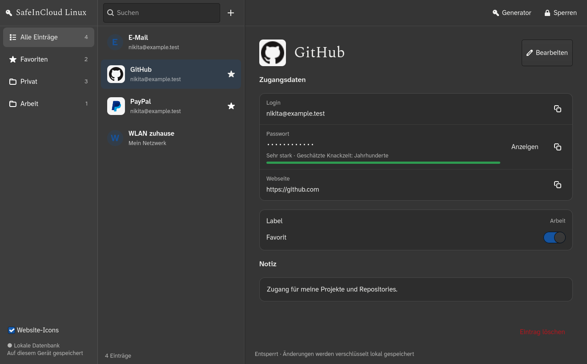

# SafeInCloud Linux

A minimal, unofficial native Linux client for your SafeInCloud passwords:
**search, copy, add, edit and synchronize with Google Drive**. MIT-licensed.
The interface follows the original application's list/detail workflow with a
simpler set of actions. No affiliation with SafeInCloud SAS.



The selected interface combines the light Adwaita layout (design 1) with the
Register typography (design 2): Atkinson Hyperlegible Next for controls, Spectral
for titles, and Red Hat Mono for masked/revealed values. These open-source fonts
are bundled locally, including their SIL Open Font License notices, so the native
app does not need to fetch fonts from the network. The three panes keep labels,
searchable entries and grouped details visible together. Search, add, edit and
lock are also available with Ctrl+F, Ctrl+N, Ctrl+E and Ctrl+L.

Light and dark appearance automatically follow the desktop's system preference.
On Linux the app listens to the XDG Settings portal as well as Qt's appearance
notifications, so an open window and editor update without losing pending edits.
No separate theme setting or periodic polling is required.

## What works

- Native Qt desktop with categories, existing labels and favorites.
- Mark/unmark favorites directly in the entry details; changes are encrypted and saved.
- Automatic discovery of the main database in Safe's **private Google app folder**.
- Offline access through an encrypted local working copy.
- Passwords masked by default; reveal/hide and copy with clipboard clearing.
- Click the username or password dots directly to copy the underlying value;
  copying keeps hidden passwords masked and clears the clipboard after 30 seconds.
- Simple add/edit form, local autosave and encrypted recovery backups.
- Drive check on unlock and after accepted edits; manual check when needed.
- Conditional cloud updates: concurrent changes are refused rather than silently
  overwritten. A newer remote version is pulled when there are no local changes.
- Automatic lock after five minutes. Lock replaces the entire GUI process,
  terminating its password-bearing heap, timers, dialogs and Drive threads.
  A small supervisor receives only encrypted recovery and source metadata,
  waits for the old process to exit, then starts a fresh locked window.
  After a failed disk write, pending edits require the master password again
  and remain only as ciphertext in memory: keep the app open until saved.
  If even recovery encryption fails, locking takes priority and pending edits
  are discarded with an explicit warning.

This is an experimental interoperability implementation. It is deliberately
smaller than the Windows app: browser autofill, passkeys, TOTP generation,
attachments UI, permanent trash deletion and automatic record-level merge are
not included. Existing unknown XML elements and attributes are preserved.

## Google Drive: the important difference

The initial prototype's independent rclone login could only see normal Drive
files. Safe normally stores its database in an app-specific hidden folder; that
folder is bound to the original application's Google registration.

The current compatibility mode reads the installed-app client configuration
**locally from an original Windows executable**, then performs a fresh Google
browser login with PKCE and a checked loopback callback. Google therefore shows
**SafeInCloud** on the consent screen. This is an independent Linux client, not
the vendor's Windows app. No client parameters, original binary or user tokens
are distributed in this repository; it does not copy Windows login tokens.

Private-folder discovery, download and metadata access have been verified on the
user-authorized live account. Conditional updates and HTTP 412 conflict rejection
were verified using a separate disposable encrypted file, which was then deleted.
The real password database was not modified by this verification.
See [Windows protocol evidence](docs/GOOGLE_WINDOWS.md).

## Fedora installation

Python 3.11+ and a graphical desktop are required. Dependencies include PySide6,
cryptography, defusedxml and the static .NET metadata readers dnfile/dncil.

```sh
git clone https://github.com/vassiljevnikita-sudo/safeincloud-linux.git
cd safeincloud-linux
python3 -m venv .venv
.venv/bin/pip install .
```

Obtain the original Portable ZIP from the
[official download instructions](https://support.safe-in-cloud.com/portal/en/kb/articles/download)
and extract it locally. Configure the absolute path to its `SafeInCloud.exe`:

```sh
mkdir -p ~/.config/safeincloud-linux
chmod 700 ~/.config/safeincloud-linux
printf '%s\n' '{"path":"/absolute/path/SafeInCloud_Portable/SafeInCloud.exe"}' > ~/.config/safeincloud-linux/official-client.json
chmod 600 ~/.config/safeincloud-linux/official-client.json
.venv/bin/safeincloud-linux
```

Click **Google Drive verbinden** once and complete the browser consent. A single
`SafeInCloud.db` opens automatically; if several ambiguous databases exist, choose
once and the application remembers its stable Google file ID. Enter your master
password only in the local unlock screen. Subsequent launches use the encrypted
working copy immediately and check Drive after unlocking.

You can also open a local database directly:

```sh
.venv/bin/safeincloud-linux /path/to/SafeInCloud.db --gui
```

Without `--gui`, a file argument retains the CLI that prompts for the password
and lists titles/IDs. `--show CARD_ID` explicitly prints one entry to the terminal.

On this Fedora laptop the repository, tools and installed runtime live under
`/data-ssd/codex-artifacts/safeincloud-linux/`, as requested. The existing app-menu
launcher points to that installation; there is no Windows VM or Wine dependency.

## Data and recovery

OAuth refresh tokens: `$XDG_CONFIG_HOME/safeincloud-linux/official-google-token.json`
(default `~/.config/...`), mode 0600. Original executable reference and remembered
file ID are in the same private configuration directory. Never share token files.

Encrypted working copies and backups: `$XDG_DATA_HOME/safeincloud-linux/vaults/`
(default `~/.local/share/...`). The laptop's data directory points into `/data-ssd`.
Successfully saved local edits survive restarts and failed uploads. Concurrent changes require
manual resolution; this version does not merge two edited vaults automatically.

Keep your existing independent backups. The legacy CBC file format is not
cryptographically authenticated. Python cannot guarantee secure memory erasure;
the desktop therefore terminates the secret-bearing process on lock rather than
relying on deleting Python/Qt objects. Linux core dumps and ordinary same-user
process-memory access are disabled before the session opens. This does not
protect against root, a compromised client, prior captures, swap or clipboard
history maintained by another application. A Drive request interrupted by lock
can require a fresh check or conflict resolution; it never silently merges data.
No plaintext vault is written to disk by the application. Current official-client
roundtrips of every possible XML feature are not established; details are in
[writing notes](docs/WRITING.md) and [format notes](docs/FORMAT.md).

## Development and verification

```sh
QT_QPA_PLATFORM=offscreen .venv/bin/python -m unittest discover -s tests -v
```

The suite covers the external public sample, Unicode strategies, CRUD and backup
preservation, OAuth/PKCE callback validation, app-folder requests, conditional
uploads, offline pending edits and the Qt source/editor flows. Synthetic UI tests
use fictional records. Live Drive checks are documented separately from mocked
tests; test counts do not imply complete vendor feature compatibility.

## Research and visual references

[REA](https://github.com/morluto/rea) 6.5.0 was used to inspect the original managed
artifact and selected Google driver methods. Ghidra and focused .NET IL inspection
were also used. See [research record](docs/RESEARCH.md).
The Windows layout reference was the publicly available
[SafeInCloud screenshot](https://windows-cdn.softpedia.com/screenshots/Safe-In-Cloud_3.png).
No vendor screenshot or proprietary application code is bundled.

## Credits

MIT. Format work builds on Max Schmitt's
[golang-safe-in-cloud](https://github.com/mxschmitt/golang-safe-in-cloud), inspected
at `8819e485adaa349c404735509dae0540534b6ac3`. Its sample and original license are
preserved in [THIRD_PARTY_LICENSE](THIRD_PARTY_LICENSE).
